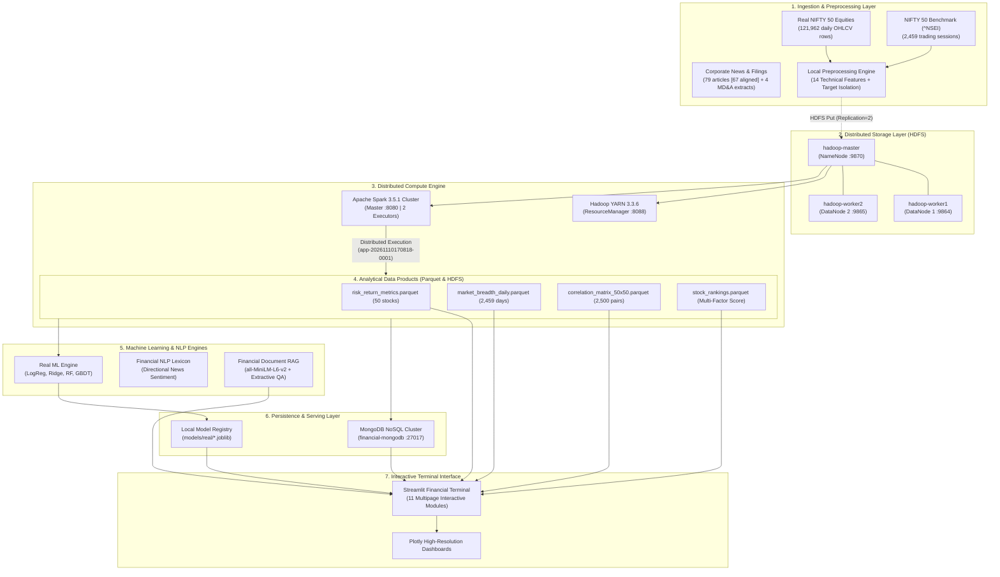

# Distributed System Architecture & Infrastructure Topology

**Course:** CSBB 422 — Big Data Analytics Lab  
**Institution:** National Institute of Technology Delhi  
**Project:** Financial Intelligence & Big Data Analytics Platform  
**Target Market:** National Stock Exchange of India (NSE) — NIFTY 50 Index  

---

## 1. Overview & Academic Topology Statement

The **Financial Intelligence & Big Data Analytics Platform** is an academic big data processing, financial econometrics, and machine learning platform designed to ingest, process, model, and visualize 10 years of Indian equity market data (2015–2024).

### Academic Hardware & Cluster Reality Disclosure
> [!IMPORTANT]
> **Single-Host Containerized Logical Cluster:**  
> For academic reproducibility and laboratory evaluation, the distributed storage and processing layers are implemented as a **three-node logical cluster hosted inside Docker containers on a single physical host machine** (Windows 11 with WSL2 Linux subsystem backend).
> 
> - It is **NOT** a cluster running across three discrete physical hardware servers.
> - However, it executes **genuine distributed daemons** (`NameNode`, `DataNode`, `ResourceManager`, `NodeManager`, `SparkMaster`, `SparkWorker`) across separate container network boundaries with configured replication ($R=2$), YARN resource isolation, and remote RPC protocols.

---

## 2. End-to-End System Topology

---

## 3. Containerized Node Specifications

The distributed services run on a dedicated Docker bridge network (`bigdataproject_default` / `172.18.0.0/16`):

| Node / Container Name | Service Roles & Daemons | Memory Limit | Exposed Ports | Function in Platform |
| :--- | :--- | :--- | :--- | :--- |
| **`hadoop-master`** | `NameNode` `ResourceManager` `Spark Master` `JobHistoryServer` | 4,096 MB | `9870` (NameNode UI) `8088` (YARN UI) `8080` (Spark Master UI) `19888` (JobHistory) `7077` (Spark RPC) | Orchestrates block storage, YARN application master scheduling, and distributed Spark DAG dispatching. |
| **`hadoop-worker1`** | `DataNode` `NodeManager` `Spark Worker` | 3,072 MB | `9864` (DataNode 1) `8042` (NodeManager 1) `8081` (Spark Worker 1) | Hosts Block Replica 1, executes YARN mapper/reducer containers, and runs Spark Executor 1 (1 core, 1 GB). |
| **`hadoop-worker2`** | `DataNode` `NodeManager` `Spark Worker` | 3,072 MB | `9865` (DataNode 2) `8043` (NodeManager 2) `8082` (Spark Worker 2) | Hosts Block Replica 2, executes YARN mapper/reducer containers, and runs Spark Executor 2 (1 core, 1 GB). |
| **`financial-mongodb`** | `mongod` 6.0 | 2,048 MB | `27017` (MongoDB Wire Protocol) | Persists enriched financial metrics, corporate entities, stock rankings, and user session cache. |

---

## 4. Storage Architecture (HDFS & Local Parquet)

### HDFS Namespace Layout (`/financial-intelligence/real/`)
- `/financial-intelligence/real/market/`
  - `consolidated_market_features.parquet` (26.2 MB): 121,962 rows across 50 equities.
  - `benchmark_features.parquet` (294 KB): 2,459 official NIFTY 50 benchmark sessions.
  - `daily_features/`: 50 individual equity parquet files.
- `/financial-intelligence/real/analytics/`
  - `risk_return_metrics.parquet`: 50 equities with CAGR, annualized volatility, Sharpe ($R_f=6.0\%$), CAPM Beta, Alpha, Max Drawdown.
  - `market_breadth_daily.parquet`: 2,459 sessions with Advance/Decline ratios and Moving Average participation percentages.
  - `correlation_matrix_50x50.parquet`: 2,500 pairwise daily return correlation cells.
  - `stock_rankings.parquet`: 50 equities ranked by multi-factor composite investment score.
- `/financial-intelligence/real/news/`
  - `cleaned_financial_news.csv` (79 corporate disclosure records; 67 aligned with trading sessions).
  - `daily_company_news_features.csv`.
- `/financial-intelligence/real/documents/`
  - 4 verified FY24 annual report MD&A extract files.

---

## 5. Compute Engine & Execution Workflow

1. **Ingestion & Feature Engine (`src/features/`):**
   - Calculates 14 stationary technical indicators including log returns, momentum, rolling annualized volatility ($\sqrt{252}$ scaling), moving average ratios (`close_to_ma20/50/200`), and benchmark-relative returns.
   - Applies strict anti-leakage isolation: targets are constructed via strict $t+1$ lead shifts and dropped from feature sets.
2. **Distributed Spark Processing (`src/analytics/`):**
   - PySpark jobs submit DAGs to `spark://hadoop-master:7077`.
   - Data is partitioned across worker nodes using hash partitioning on equity `symbol` and `date`.
   - Spark executes map-side aggregations, broadcast joins for benchmark metrics, and parallelized covariance matrices.
3. **Machine Learning Pipeline (`src/ml/`):**
   - Models are trained on out-of-sample chronological date partitions (Train 2015–2021, Val 2022–2023, Test 2024).
   - Logistic Regression, Ridge Regression, Random Forest, and Gradient Boosting models persist in `models/real/`.
4. **Retrieval-Augmented Generation (`src/rag/`):**
   - SentenceTransformer (`all-MiniLM-L6-v2`) generates 384-dimensional dense vectors.
   - Vector cosine retrieval is combined with lexical keyword matching and confidence-thresholded extractive question answering.
5. **Presentation Layer (`app/`):**
   - Streamlit terminal interface with 11 specialized dashboards.
   - Dual-scope switcher allows instant toggling between Real NIFTY 50 Market History and Synthetic Baseline without data contamination.
